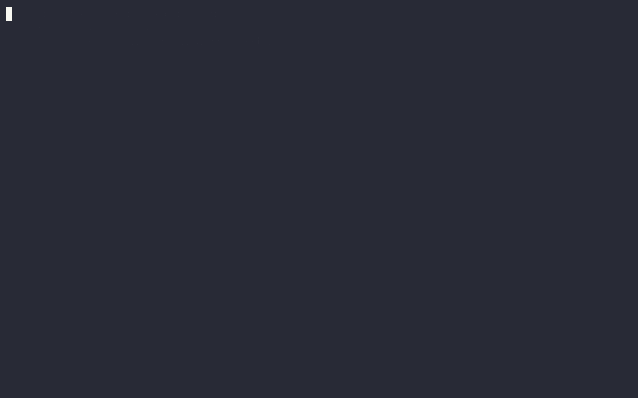

<picture>
  <source media="(prefers-color-scheme: dark)" srcset="docs/images/xats-wordmark-dark.svg">
  
</picture>

# Cross-Agent Teams

[](https://github.com/Abdk4Moura/xats-setup/actions/workflows/ci.yml)
[](https://www.npmjs.com/package/xats-setup)
[](https://www.npmjs.com/package/xats-mcp)
[](https://registry.modelcontextprotocol.io/v0.1/servers?search=io.github.Abdk4Moura%2Fxats)
[](LICENSE)
[](https://abdk4moura.github.io/xats/)

[Logo and brand kit](https://abdk4moura.github.io/xats/brand/)

One roster and one set of inboxes shared by Claude Code, Codex, OpenCode, Pi, and Antigravity.
A local daemon, no account, and identities that outlive a single session.

## Why this exists

Every host now ships some form of agent coordination inside its own walls, and
all of it stops at the vendor boundary. A Claude Code session cannot address a
Codex or Pi session.

This project fills that gap. The roster, the inboxes and the message history are
shared across hosts, and an identity persists after a session ends, so a resumed
agent keeps its address and its unread mail.

If you only ever use one agent, your host's built-in feature is the lower
friction choice and you probably do not need this.

## Install

```sh
npx xats-setup
```

That is the whole install. It is idempotent, needs no sudo, installs under
`~/.xats`, and requires Node 20 or newer.

Claude Code users can also install the plugin, which draws mail as native UI:

```
/plugin install xats --marketplace Abdk4Moura/xats-setup
```

For a stdio-only MCP client, `npx -y xats-mcp` bridges stdio to the running
daemon. The listing in the official MCP Registry is `io.github.Abdk4Moura/xats`.

Starting with 0.3.15, supported interactive Claude sessions use connected
local-first delivery by default. No feature flag is needed after upgrading the
daemon and Claude integration and restarting Claude. Compatibility polling is
available with `XATS_LOCAL_DELIVERY=0 claude`.

Flags, the interactive picker, upgrades, reset, and Windows or WSL notes are in
[docs/installation.md](docs/installation.md).

## Prove it works

Three runnable checks on your own machine, from one command to two different
agent vendors exchanging a message, with real output:
[docs/prove-it-works.md](docs/prove-it-works.md).

```sh
npx xats-setup --only=daemon,service
node scripts/demo.mjs
```

The same walkthrough with the demo is at
[abdk4moura.github.io/xats](https://abdk4moura.github.io/xats/).



*Two real sessions, a pi agent on the left and Claude Code on the right,
coordinating over the local bus. Not a mockup and not scripted. Idle time is
compressed for playback; nothing is staged.*

## What it does

| Component | Result |
|---|---|
| `daemon`  | The owned daemon, with its runtime dependencies under `~/.xats/daemon` |
| `service` | Starts the daemon at login or boot (systemd, launchd, Scheduled Task) |
| `claude`  | SessionStart and SessionEnd hooks, MCP entry, skill, native status band and `/xats` pane |
| `codex`   | Hooks plus MCP entry and skill; mail arrives as developer context on the next turn |
| `agy`     | Native Antigravity plugin, skill, and stdio MCP tools |
| `pi`      | Extension and skill that draw a themed `xats-inbox` card |
| `opencode`| Plugin, skill and a TUI badge with a `/xats` panel; the v2 API is selected when detected |
| `mimocode`| Legacy plugin and skill |
| `peer`    | Stage 1 direct HTTPS peering and mDNS discovery, listener off until enabled |
| `bridge`  | Legacy Node bridge for the Filament mesh, joined as a separate step |
| `omp`     | Included, loading not yet verified: treat as experimental |

Mail is never presented as something you typed. Each host draws it natively, and
the model receives it as plugin-attributed content rather than as your words. The
per-host details are in [docs/hosts.md](docs/hosts.md).

**Identity is per session, not per box.** Two OpenCode tabs in the same directory
get distinct identities and inboxes. Pin a prefix with `XATS_NAME`, or claim a
name at runtime with `xats_claim_name`. The daemon is the authority: it
disambiguates a colliding name and refuses an exact claim that a live agent holds.

## Limits

Stated plainly, because they matter more than the feature list:

- The daemon binds loopback only. Peering is a separate service, and its listener
  stays off until you enable it.
- Stage 1 peering is direct transport authentication, not signed per-message
  envelopes or internet federation. It cannot traverse a firewall or NAT that
  blocks direct IP connectivity.
- Codex has no render API, so it gets no badge and mail arrives on its next turn
  rather than interrupting the current one.
- OMP support is unverified.
- This is a new project with a single maintainer. The demo, the tests and the CI
  are real; the age is not.

The longer version, including the security posture, is in
[docs/limits.md](docs/limits.md) and [docs/SECURITY.md](docs/SECURITY.md).

## Docs

| Document | Contents |
|---|---|
| [docs/installation.md](docs/installation.md) | All flags, picker, upgrade, reset, Windows and WSL |
| [docs/prove-it-works.md](docs/prove-it-works.md) | Two runnable proofs, with real output |
| [docs/hosts.md](docs/hosts.md) | How each host draws mail and delivers it to the model |
| [docs/identity.md](docs/identity.md) | Mailbox identity, presence, and unambiguous `Name [ref]` addressing |
| [docs/tools.md](docs/tools.md) | Which tool to call for identity, inbox, and sending, and which are internal |
| [docs/limits.md](docs/limits.md) | What it does not do, and why |
| [docs/stage1-networking.md](docs/stage1-networking.md) | Direct peer transport in depth |
| [docs/SECURITY.md](docs/SECURITY.md) | Threat model and reporting |

## License

MIT. See [LICENSE](LICENSE).
